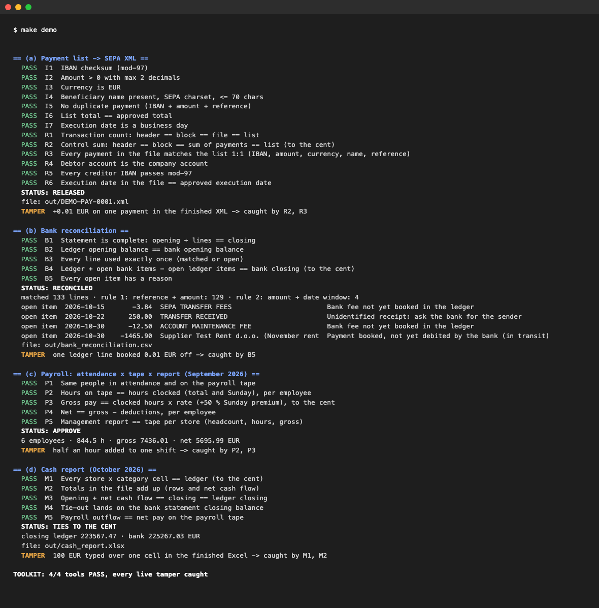
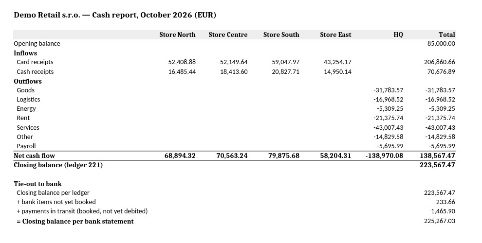
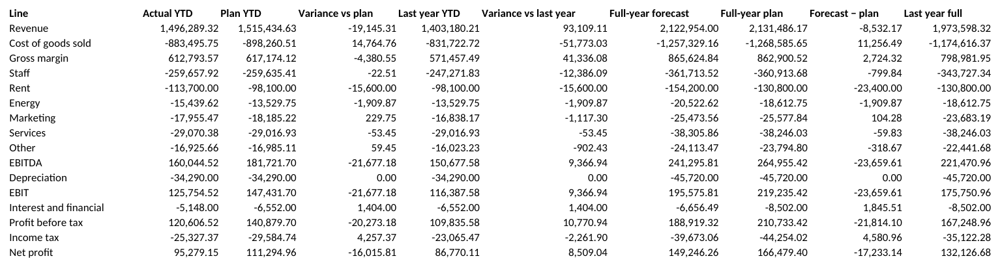
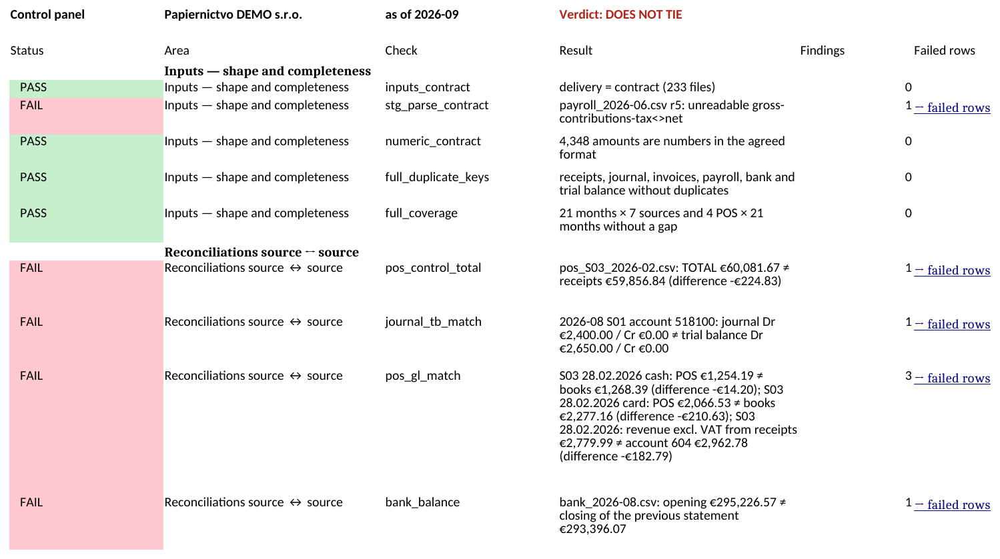

# Finance automation portfolio

**A finance controller's toolkit for numbers that have to be right before anyone sees them.**

I work as a financial controller, not a software engineer. Over the past year I
have used AI (Claude) to automate the parts of finance work that are repetitive,
error-prone and expensive when they go wrong: monthly reporting, payment runs,
bank reconciliation, payroll checks and management reports.

Everything in this repository runs on **fictional companies and generated data**.
No client, employer or person is represented here.

## What problems this solves

| Problem in a finance team | What is here | How you know it is right |
|---|---|---|
| Monthly reporting from many sources takes days and breaks silently | [`reporting-pipeline/`](reporting-pipeline/) — source files → checks → board pack in Excel · [see the output](examples/reporting-pipeline/board-pack.pdf) | 12 source-to-source reconciliations; the board pack is not issued if any fails |
| Payment runs typed or copied by hand | [`finance-ops-toolkit/`](finance-ops-toolkit/) (a) — payment list → SEPA XML · [see the output](examples/finance-ops-toolkit/sepa-payments.xml) | The finished XML is read back and must equal the approved list to the cent |
| Bank statement matched line by line | (b) bank reconciliation · [see the output](examples/finance-ops-toolkit/bank-reconciliation.csv) | Every line matched or listed as an open item with a reason |
| Payroll: attendance, payroll tape and report disagree | (c) payroll three-way check | Hours × rate = tape = report, per employee |
| Management cash report built by hand | (d) cash report · [see the output](examples/finance-ops-toolkit/cash-report.xlsx) | Ties to the ledger to the cent |
| ERP set up by hand, bank ticked off line by line, cost per store typed | [`odoo/`](odoo/) — Odoo 17 Community demo from one command: stores as analytic accounts, CAMT import + matching over the ORM, weekly pack · [see the output](examples/odoo/weekly-verdict-2026-W39.html) and the [decision log](odoo/decisions/) | Setup read back bill by bill; the month is RECONCILED only if every bank line is matched or explained; the weekly pack is read back from the saved Excel and tied to the ledger |
| "How do you actually work with AI?" | [`working-with-claude/`](working-with-claude/) — templates and skills I use daily | — |

## The one idea behind all of it

**A check that cannot fail is not a check.**

Every tool here checks its own output, and every check in the finance ops
toolkit has a *tamper test*: the
test deliberately breaks the data (one cent, a swapped IBAN, a missing row) and
proves the check catches it. If a check stays green while the data is wrong,
the test suite fails.

`make demo` runs every tool on the fictional data, then breaks each output once
on purpose and shows which check caught it:



The cash report is read back from the finished Excel file and tied to the
ledger, the bank statement and the payroll tape, to the cent:



**See the output:** [cash-report.xlsx](examples/finance-ops-toolkit/cash-report.xlsx) · [SEPA XML](examples/finance-ops-toolkit/sepa-payments.xml) and [its checks](examples/finance-ops-toolkit/sepa-checks.txt)

## Reporting pipeline in two pictures

Nine kinds of source files, 21 months, about 380,000 rows for a fictional stationery
chain. When every check passes, the board pack is issued (labels are in Slovak:
*Tržby* = revenue, *Odhad roka* = full-year forecast):



**See the output:** one-page management summary [in English](examples/reporting-pipeline/management-summary-en.pdf) / [po slovensky](examples/reporting-pipeline/management-summary-sk.pdf) · full detail: [board-pack.pdf](examples/reporting-pipeline/board-pack.pdf) · [board-pack.xlsx](examples/reporting-pipeline/board-pack.xlsx)

When the delivery contains errors (here 7 were planted on purpose), there is no
board pack. Instead, the control panel names each failed reconciliation, the
file, the row and the amount:



**See the output:** one page on what failed and where [in English](examples/reporting-pipeline/errors-summary-en.pdf) / [po slovensky](examples/reporting-pipeline/errors-summary-sk.pdf) · full detail: [control-panel-with-errors.pdf](examples/reporting-pipeline/control-panel-with-errors.pdf) · all example files: [`examples/`](examples/)

## Try it

Requires Python 3.11+, `git` and `make`. The block can be pasted into a terminal as it is:

```bash
git clone https://github.com/mvajcik/finance-automation-portfolio.git
cd finance-automation-portfolio
make demo
```

`make demo` runs every tool on the fictional data and prints the verdicts. The first run also creates a
virtual environment, installs the packages and generates the data.

Further commands, run from the same folder:

| Command | What it does |
|---|---|
| `make test` | all checks and tamper tests (about 2 minutes) |
| `make test-fast` | the same without the reporting pipeline (seconds) |
| `make odoo-demo` | the Odoo 17 Community demo (needs Docker; own containers on port 8071) |

## About the data

- **Demo Retail s.r.o.** and **papiernictvo2** (a fictional stationery chain) are
  invented. Their data is produced by generators in this repository. The Odoo demo uses the
  same Demo Retail fiction with three of its stores.
- IBANs in the finance ops toolkit are official example IBANs from the SWIFT IBAN
  Registry; the reporting pipeline generator uses obviously fake ones (zeros and nines).
- Names of suppliers and employees are invented and intentionally read as fake.
- The reporting pipeline keeps its original Slovak labels; this README and the
  finance-ops-toolkit are in English.
